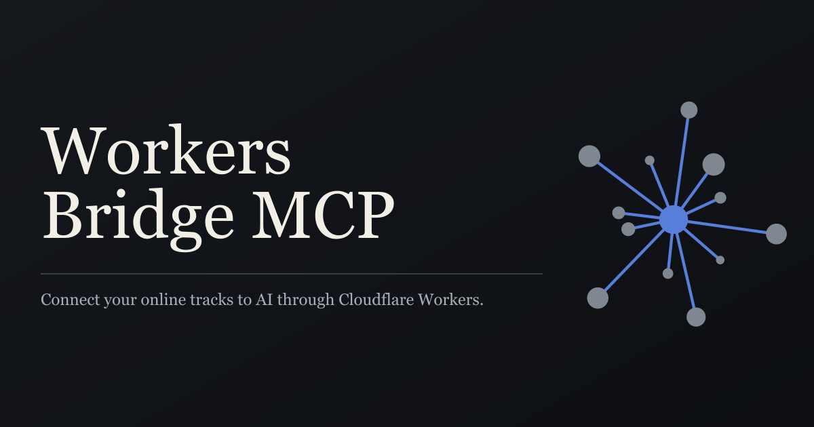

# Workers Bridge MCP



This guide connects the stdio MCP server to Codex CLI and fetches authenticated
YouTube, X, and Reddit data through direct destination connections. Worker
relay configuration is covered in [docs/manual.md](docs/manual.md).

## Before you start

- macOS for the bundled Chrome cookie exporter (manual DevTools export works on
  any platform).
- Python 3.12+ and [uv](https://docs.astral.sh/uv/).
- Codex CLI.
- Chrome signed in to the services you want to read, in the profile you will
  export from.

## 1. Register with Codex CLI

### Register a user-level server

Add this table to `~/.codex/config.toml` (create the file if it does not
exist). It must be at the top level, not inside another table:

```toml
[mcp_servers.workers-bridge]
command = "uvx"
args = ["mcp-workers-bridge"]
startup_timeout_sec = 30
tool_timeout_sec = 300
env_vars = [
  "YOUTUBE_STORAGE_STATE_JSON",
  "YOUTUBE_TIMEZONE",
  "X_STORAGE_STATE_JSON",
  "REDDIT_STORAGE_STATE_JSON",
  "S3_CACHE_BUCKET",
  "SERVICE_BRIDGE_WORKER_URL",
  "CF_ACCESS_CLIENT_ID",
  "CF_ACCESS_CLIENT_SECRET",
  "AWS_REGION",
  "AWS_PROFILE",
  "AWS_CONFIG_FILE",
  "AWS_SHARED_CREDENTIALS_FILE",
  "AWS_WEB_IDENTITY_TOKEN_FILE",
  "AWS_ROLE_ARN",
  "REQUESTS_CA_BUNDLE",
  "CURL_CA_BUNDLE",
  "SSL_CERT_FILE",
  "HTTP_PROXY",
  "HTTPS_PROXY",
  "NO_PROXY"
]

[mcp_servers.workers-bridge.env]
PYTHONUNBUFFERED = "1"
LOCAL_CACHE_ROOT = "/path/to/private-cache-root"
# MCP_APPROVE_FOR_ME = "1"
# MCP_WITHOUT_COOKIE = "1"
```

Replace the cache path with an absolute path. The `env_vars` entries are names
that must exist in the Codex process environment; they are not values. Restart
Codex after adding or changing the table.

Alternatively, let Codex create the `command`/`args` entry:

```bash
codex mcp add workers-bridge -- uvx mcp-workers-bridge
```

That shortcut registers a stdio server named `workers-bridge`, but still add
the `env` and `env_vars` sections manually. Codex stores `uvx` as the command
and `mcp-workers-bridge` as its argument; at MCP startup, uvx resolves and runs
the published package.

Chrome cookie extraction is included in the default install. Codex runs the
published package on demand.

Environment variables must be declared inside the Codex session: `env_vars`
only forwards variables that the Codex process inherited at startup. Exports
from a separate terminal, or added after Codex started, are not visible to the
MCP server. Restart Codex after changing the config or environment.

### Modes

Set mode values in the MCP server entry in `~/.codex/config.toml`.

To enable without-cookie mode, add `MCP_WITHOUT_COOKIE = "1"` to that table's
`env` map.

`MCP_WITHOUT_COOKIE=1` hides every cookie-backed tool at startup. It exposes
only `bridge_configuration`, `workers_bridge_probe`,
`workers_youtube_captions`, `workers_x_asset`, `clear_cookie_state`, and
`clear_cache`.

Add this under the same `[mcp_servers.workers-bridge.env]` table:

```toml
MCP_APPROVE_FOR_ME = "1"
```

`env` values are literal TOML values, so no shell expansion is involved.
`MCP_APPROVE_FOR_ME=1` asks for the Chrome Safe Storage password once, then
caches it in `~/.private/mcp-workers-bridge/chrome-safe-storage` with mode 600.
Delete that file to revoke the cached approval. The first extraction still
requires the macOS approval. Restart Codex after editing the table.

`bridge_configuration` reports both `cookie_mode` and `approve_for_me`.

## 2. Extract cookies and set the environment variables

Direct mode uses these variables:

| Data | Minimum variable |
| --- | --- |
| YouTube history | `YOUTUBE_STORAGE_STATE_JSON` |
| X | `X_STORAGE_STATE_JSON` |
| Reddit | `REDDIT_STORAGE_STATE_JSON` |
| YouTube local cache | `LOCAL_CACHE_ROOT` |
| YouTube captions only | none |

In Codex Cloud, automatic Chrome cookie extraction is disabled. Provide
storage-state values through the environment or enable
`MCP_WITHOUT_COOKIE=1`; `MCP_DISABLE_COOKIE_EXTRACTION=1` disables extraction
explicitly in other environments.

### Local cache

Add the cache root to `[mcp_servers.workers-bridge.env]` as a literal value:

```toml
LOCAL_CACHE_ROOT = "/path/to/private-cache-root"
```

TOML does not expand `$HOME` or `$VAR`, so use an absolute path. The cache key
can sit alongside `MCP_APPROVE_FOR_ME` in the same env table.

## 3. Verify the connection

```bash
codex mcp list
```

## Documentation

- [PyPI package](https://pypi.org/project/mcp-workers-bridge/): published
  server package used by `uvx mcp-workers-bridge`.
- [docs/manual.md](docs/manual.md): full configuration, tool reference, cache,
  acceptance results, and security boundaries.
- [docs/environment.md](docs/environment.md): environment variable and mode
  reference.
- [docs/deploying.md](docs/deploying.md): Cloudflare API token permissions,
  dependency installation, and Worker/Access deployment.
- [docs/codex-cloud.md](docs/codex-cloud.md): Codex Cloud setup, secrets, OIDC,
  and S3 permissions.
- [infra/service-bridge-workers/README.md](infra/service-bridge-workers/README.md):
  Worker deployment, Terraform, Access, and acceptance runbook.
- [infra/service-bridge-workers/API.md](infra/service-bridge-workers/API.md):
  HTTPS contract.
